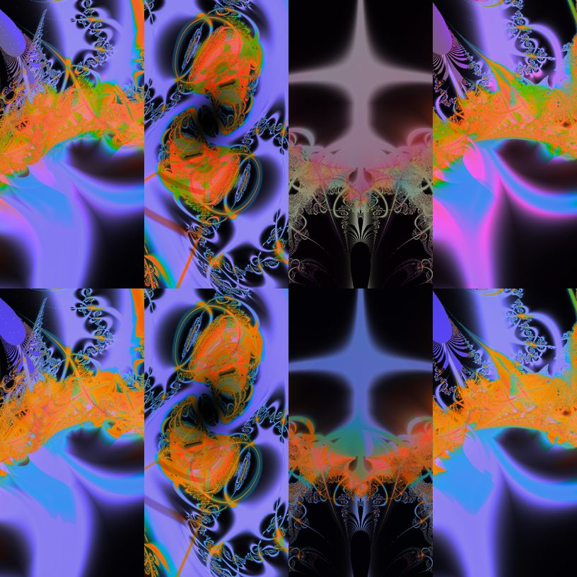

# clit-set

A series built on clit/2: Dom Mandy's complex power fractal, read as a chromadepth body with lace
filigree, a red focal ember and a velvet-violet floor. The sun set told a solar arc. This set tells a
voyage: you drift slowly through a vast fractal place, get lost in it, and keep coming back to the
landmark (the clit/2 silhouette).

```
?shader=clit-set/2&controller=clit-set
```

Every shader renders without the controller (each `cs_*` reads 0, and the shader falls back to raw
knobs and features). With the controller, the motion glides and the autopilot voyage runs.

## clit-set/2: the voyage

### Intent

- Every dial at 0 is a good look. After a reload all Twister dials read 0. At 0, the autopilot is on:
  the camera drifts through six waypoints and returns home every 10 minutes.
- Knobs steer. The controller eases every move through a two-pole glide (about 2 s), so a dial
  twist feels like floating, not a cut.
- Audio is texture on the journey. It never touches the fractal coordinates (A, B, C, zoom, pan,
  rotation, curl). On clit/4, audio in the coordinates made the frame strobe and black out.
- Zoom is capped at 3x. Past 3x to 4x the orbit-trap lace turns into speckle. The lost feeling comes
  from pan, power, body and curl, which change the place itself.
- Galactic motif: nebula dust tinted by the orbit colour, and two parallax star layers that drift at
  a fraction of the camera's motion, so travel reads as travel. No sun, no arc.

### Knob map (MIDI Fighter Twister, 4x4)

| Row | Dial 1 | Dial 2 | Dial 3 | Dial 4 |
|-----|--------|--------|--------|--------|
| 1 navigate | **k1 X** pan sideways | **k2 Y** pan up/down | **k3 VOYAGE** scrub the loop | **k4 ZOOM** 1x to 3x |
| 2 shape | **k5 TURN** rotate the view | **k6 POWER** fractal power | **k7 BODY** body offset | **k8 CURL** ribbon curl |
| 3 colour | **k9 HUE** palette turn | **k10 NEBULA** dust and stars | **k11 TRAILS** feedback | **k12 REACT** audio size x1 to x2.5 |
| 4 light | **k13 GLASSES** strict chromadepth | **k14 EMBER** focal size | **k15 SPOT** hold drop spotlight | **k16 LACE** lace density |

- **k1, k2, k3 at 0 = autopilot.** X and Y push the camera from wherever the voyage has it: the
  offset is the dial value times `PAN_SPAN` (0.8 in the fractal plane, about two-thirds of the screen
  height). A nudge from 0 to 0.1 moves 0.08, so a small turn is a small move. The push is one way;
  TURN (k5) half a turn flips which way it reads on screen. (Before 2026-11-21, X and Y were bipolar
  around 0.54, so the first 8% of the dial swung the camera to the far edge.)
- k3 blends from the autopilot to a hand scrub over its first 8%, along the shorter way round the
  loop (5.9 to home goes forward through 6, never back through 4, 3, 2, 1). Past 8% it scrubs the
  loop by hand (0.08 = home, 1.0 = the end of the loop).
- k4 to k8 add on top of the voyage, so they also work while the autopilot runs.
- Ranges: ZOOM adds up to 1.1 log units (3x, capped). TURN is one full turn. POWER adds up to +1.4
  to A. BODY subtracts up to 0.4 from B. CURL adds up to 0.45 rad of rotation per iteration.

### `voyage0`: where the journey starts

`?voyage0=<u>` sets the autopilot's start position on the first frame. Units are waypoints:
`0` = home, `1` = ribbon cathedral, `2` = vortex eye, and so on. Values wrap modulo 6 (the
number of waypoints), so any number works. One unit is 80 s of journey, and a full loop is 480 s.
Fractions land between places: each unit is one glide to the next waypoint, never parked (the
glide speed stays above 40% of linear even at the waypoint). Missing means 0, the original behaviour. NFC variants can use `n * 0.618 mod 6`.

### Waypoints (`WAYPOINTS` in `controllers/clit-set.js`)

| # | Name | What it is |
|---|------|------------|
| 0 | home | clit/2 as committed: the silhouette, pale star, red focal ember |
| 1 | ribbon cathedral | curl 0.3: the wings twist into ribbons (the 2026-05-02 "ribbons curling" request) |
| 2 | vortex eye | panned into the right wing with curl, 2.1x. An approximation of the iter-41 composition; its exact knob code did not survive |
| 3 | jellyfish tendrils | near the pale star, long ribbons over open dark, focal at the edge (iter 29) |
| 4 | fern galaxy | A 1.99, B 0.43, curl 0.22: dense fern lace with teal pockets |
| 5 | rose carpet | A 2.45, B 0.3: a full-field rose and teal carpet, the farthest region from home |

Each leg glides for its whole 80 s. Mid-glide, the camera pulls back a little, so each leg reads as
rising, flying and settling. On top of the voyage, an always-on **spin** turns the view one way only
(0.02 rad/s in silence, 0.02 to 0.06 rad/s following the energy z-score). The music changes the spin's
rate, never its direction. Nothing on the geometry oscillates: no sine on zoom, pan or rotation.

### Colour: OKLCH kit, theme EMBER & NEBULA (2026-11-22)

Aaron: "We also need to reinplement using oklh like this repo currently recommends with a thematic color palette".
All four clit lace shaders (clit-set/1, clit-set/2, clit-vibej/1, clit-vibej/2) now build their colour on the
repo's OKLCH harmony kit ([docs/oklch-palettes.md](../../docs/oklch-palettes.md)): the kit block is pasted in
verbatim, and the series palette is one theme on top of it.

- **The theme.** A warm body adrift in a cold galaxy. The lace is the body: ember red and burnt amber. The
  galaxy is cool: teal (the kit's split complement of the ember) and indigo velvet (the darkest lace, the pale
  star's tint). Warm = near and cool = far, so the theme agrees with ChromaDepth glasses even at GLASSES 0.

  | key | hue (turns) | at `THEME_H` 0.095 | role |
  |---|---|---|---|
  | ember | `THEME_H` | 34° | lace, ties, rails' base |
  | amber | `+0.04` | 49° | lace, rails, pearls |
  | teal | `+5/12` | 184° | braid, rim, nebula |
  | indigo | `+0.64` | 265° | darkest lace, pale star |

- **One base hue.** The seed turns `THEME_H` within 27..41° only, so indigo stays at 257..272°. It sits that far
  below the magenta arc (288°) because the tone map's per-channel gamma and the trails lean violet about 20°
  pinkward on screen: at `+0.68` (272..286°) a pale indigo displayed at 310..330°, orchid.
- **Dials move the position, not the hues.** `HUE_TURN`, `cs_hue`, `cs_jump`, `cs_shift` and the tone lean move
  `pal_t` along the palette. No dial can take the series off-theme.
- **The palette position** is the orbit angle as a triangle wave (ember … indigo … ember), so it never wraps
  across magenta. `themeCol(pal_t, L, C)` glides between the keys in OKLab (`ramp4`) and holds each key
  for the outer quarters of each leg (`themeHold`), so the far amber → teal step has little olive in it.
- **Lightness** comes from the orbit rainbow's luma (the lace structure), never from `pal_t`. The band is
  OKLab L 0.16..0.70, darker than the kit's 0.45..0.85: the series is velvet on black. At a 0.13 floor the
  darkest lace (the fan petals) went near-black and read grey; at 0.20 the fine lace shimmered (below).
- **Chroma** is requested past the kit's 0.13 and `okFit` maps it to the sRGB edge at constant L and hue: the
  series rule is never grey.
- **Guards after the palette.** The beat's hue rotation (2.frag) turns already-coloured pixels, so it can still
  reach magenta or green. It may not carry a pixel into the hot-magenta arc (-1.25..0.45 rad, vibej iter 3),
  nor deeper into it, nor into the green gap (90..160°); the turned hue is wrapped back into (-π, π] first.
  The vibej iter 5 output squeeze ("NEVER HOT MAGENTA") runs in all four shaders and reads the hue of the
  DISPLAYED colour: it decodes with `srgb2lin` before `rgb2oklab` (which takes linear sRGB) and writes back
  through `okOut`. Only colours near the arc pay for the decode: every displayed colour whose OKLab hue is in
  288..26° has min(r, b) > g - 0.032, so `min(r, b) > g - 0.05` gates it. The beat turn itself still works on
  the output values as main did: decoding them first cost the sparkle gate (below). Every hue angle goes
  through `okHue()`, which returns 0 for a grey: `atan(0, 0)` is NaN on some mobile GPUs.
- **ChromaDepth** (GLASSES, the focal) is rebuilt on the kit's `oklch2rgb` with display-correct lightness: true
  red (29°, near) to violet (293°, far). Physics, not theme: the seed does not turn it.
- **LACE AA** composes unchanged: each orbit sample computes its theme colour in `laceSample()` (in OKLab), and
  the pixel averages the samples' gamut-fitted colours weighted by coverage.
- **The braid** (where both traps cross) mixes the lace colour 45/55 with cream, as on main, and over the
  darkest lace the cream turns violet `(0.56, 0.48, 1.0)`. Cream over near-black petals read khaki.
- **Cost.** `gamutT` uses vector selects instead of the kit's loop over `c[i]` (same result; on SwiftShader the
  loop cost 10..20% of the frame), `lin2srgb` encodes with three square roots (within 0.4/255 of the `pow`),
  the rim, focal, dust bass lean, ties and rails take their colour only where they show, and dust reuses the
  fitted lace colour (`shadeTo`) instead of a second fit.
- **clit-set/1** was the raw sexy/1 rainbow (58% of lit pixels grey on a phone, 14% hot magenta). It is
  hand-ported: the rainbow keeps only its luma (lightness), the hue turn moves `pal_t`, pearls are pale gold
  (were lilac-pink), the rim walks the theme (was a violet → pink mix through the magenta arc), and the tone
  map works on luminance as in 2.frag (per-channel Reinhard greyed the pale body: 12% of lit pixels grey with
  the theme alone, 2% with the luminance tone map).



Measured on the real files, before (main at fd177884, LACE AA) and after, `scripts/sparkle-score.mjs` render
mode (synth trace, controller, warmup 240 frames, seeds 0.5, SwiftShader). Lit = max channel > 60. Grey is
perceptual: a lit pixel with OKLab chroma below 0.04 (the first tables, by HSV saturation, missed the khaki
petals). Hot magenta = lit, OKLab C > 0.06, displayed hue 310..15°; green = 90..150°.

| shader, size | saturation | grey (OKLab C < 0.04) | hot magenta | green | mean luma |
|---|---|---|---|---|---|
| clit-set/1, phone 408x816 | .264 → .593 | 50.8% → 2.7% | 14.2% → 0.6% | 0.4% → 1.1% | 50.6 → 43.5 |
| clit-set/2, phone | .628 → .637 | 0.6% → 0.5% | 21.2% → 0.6% | 8.3% → 2.3% | 92.2 → 94.6 |
| clit-vibej/1, phone | .618 → .638 | 0.9% → 0.6% | 1.5% → 0.4% | 6.3% → 1.8% | 99.5 → 101.6 |
| clit-vibej/2, phone | .647 → .659 | 2.2% → 1.6% | 1.2% → 0.4% | 8.3% → 2.9% | 87.7 → 89.7 |
| clit-set/1, desktop 1280x720 | .342 → .672 | 40.6% → 2.9% | 12.5% → 0.3% | 0.7% → 0.7% | 38.8 → 33.8 |
| clit-set/2, desktop | .688 → .705 | 1.8% → 1.2% | 13.4% → 0.4% | 14.7% → 5.0% | 69.3 → 71.8 |
| clit-vibej/1, desktop | .686 → .707 | 1.9% → 1.3% | 1.5% → 0.4% | 12.0% → 4.2% | 71.6 → 74.0 |
| clit-vibej/2, desktop | .707 → .738 | 1.5% → 1.2% | 0.5% → 0.1% | 9.9% → 2.3% | 73.1 → 74.8 |

The opening view (no controller, `noaudio`, seeds 0 and 1, seed 0.5 with the hue knob at .25; mean of the
three, phone): grey clit-set/1 50.2% → 3.2%, clit-set/2 3.4% → 3.4%, clit-vibej/1 3.6% → 3.7%,
clit-vibej/2 10.9% → 13.2%. The fan petals read violet, as on main. clit-vibej/2's extra grey is in the dense
filigree, where LACE AA averages an ember thread with an indigo one. Averaging in OKLab and restoring the
samples' chroma brought it to 9.5% but failed the sparkle gate (flipMean 10.20 against main's 9.74), so it is
not used.

The palette does not bring the sparkle back. `sparkle-score.mjs --before` (90 frames, 408x816; each run
scored against an `--ss 4` reference of its own palette; the scores are deterministic, a rerun of the same
file reproduces them to the last digit), gate passes on both:

| shader | flipMean before / after | motion before / after (ref) | refMAE before / after |
|---|---|---|---|
| clit-set/2 | 6.711 / 6.610 | 11.130 / 11.135 (7.058) | 7.138 / 7.135 |
| clit-vibej/2 | 9.739 / 9.365 | 15.744 / 15.458 (13.318) | 5.999 / 5.759 |

What the review fixes cost the gate on clit-set/2 before they were reworked (flipMean; main 6.711): the
braid as the lace's own hue lifted to a lit level +0.7, lightness floor 0.20 with indigo +0.68 +0.3, the beat
turning decoded colour +0.25, LACE AA averaging in OKLab +0.4, restoring the averaged chroma +0.4.

Frame time (SwiftShader 408x816, synth, controller, 60 timed frames, median of 3 interleaved runs against
main's files on the same server): clit-set/1 75.0 → 82.9 ms (+11%), clit-set/2 99.3 → 105.4 (+6%),
clit-vibej/1 139.6 → 138.9 (-1%), clit-vibej/2 131.9 → 140.4 (+6%).

### Audio mapping

All audio arrives through controller envelopes, which are gated by presence so that silence relaxes
to the resting look. Many features drive small effects, each on its own channel. Colour follows slow
statistics only.

| Feature | Envelope | Drives |
|---------|----------|--------|
| energyNormalized | `cs_breath` (1.5 s) | lace threshold: loud passages thicken the filigree, quiet ones thin it to a hairline. Also lace gain (x0.85 to x1.15), lace and rim chroma (x0.85 to x1.15), nebula glow |
| midsZScore | `cs_mids` | lace brightness (0.75 to 1.35) |
| trebleZScore | `cs_treb` | rim light (0.3 to 1.4) and star twinkle |
| bassZScore | `cs_bass` | whole-body pulse (7%) |
| bass onset (wavelet `bassHit`, else bass-z rising edge) | `cs_kick` | focal ember flare |
| energy and bass z, or wavelet `confirmedDrop` | `cs_drop` | drop spotlight: the body dims and the focal blazes |
| energySlope × R² | `cs_build` | rim warms; the autopilot clock runs up to 30% faster (rate only: never direction or position) |
| spectral flux and entropy change | `cs_shift` | lace bloom |
| pitchClassMedian (20 s circular mean) | `cs_hue` | slow palette turn |
| drops | `cs_jump` | palette step per drop |
| spectralCrestNormalized | `cs_pearl` (0.15 s / 0.8 s) | pearl sparkle at lace crossings |
| spectralKurtosisZScore | `cs_focus` (1.2 s) | focal radius |
| spectralSpreadNormalized | `cs_spread` (2 s) | vignette opening |
| spectralRoughnessNormalized | `cs_grit` (0.3 s / 1.5 s) | nebula shimmer |
| spectralCentroidNormalized | `cs_tone` (8 s mean) | palette leans warm on bright music, cool on dark |

### Controller outputs used by 2.frag

`cs_on, cs_flow, cs_presence, cs_kick, cs_bass, cs_mids, cs_treb, cs_build, cs_drop, cs_jump,
cs_shift, cs_hue, cs_breath, cs_pearl, cs_focus, cs_spread, cs_grit, cs_tone`, plus navigation: `cs_cx, cs_cy, cs_lz, cs_rot, cs_navA, cs_navB, cs_curl`,
plus eased knobs `cs_k9..cs_k16`. The behaviour test is `controllers/clit-set.test.js`.

## Variant frags: 3, 4, 5

Three structural forks of 2.frag, made for the NFC giveaway. Each one keeps the clit motif (the same
fractal, the same voyage, the same knob map and controller outputs) and changes how it is drawn. Every
dial at 0 is a good look on all three, and all three are high-chroma by construction (the render gate
rejects any variant whose lit pixels average below 0.075 OKLab chroma).

| Frag | Name | What is different |
|------|------|-------------------|
| 3 | chromadepth | Strict ChromaDepth: HSL hue is depth (red near, violet far), saturation 0.95, lightness ≤ 0.55, no white. Lace and focal near (red to gold by orbit angle), body mid, galaxy far. k9 = depth temperature (0.25 hot, 0.75 cool, 0/0.5/1 neutral). k13 = depth contrast. |
| 4 | nebula | Emission nebula: the body glows as lit gas, the lace burns as two filament families in two hues, and the sky is layered multi-colour dust with cross-star sparkle. OKLCH on a curated wheel (no hot magenta, olive rushed through, dark layers kept cool so nothing goes brown). k13 = filament colour split. |
| 5 | mandala | 4's colour, folded into a slowly turning kaleidoscope. The fractal is mirror-symmetric, so each fold joins seamlessly; the silhouette repeats as petals around a lit hub. Petal count 5 to 8 comes from `seed4`, so each phone differs. |

Motion and audio on 3/4/5 (geometry only goes forward, docs/vj-preferences.md; every kick lands):

- Their own motion runs on the `time` uniform and never reverses: a one-way spin about the centre
  (one turn per 200 s) and a one-way zoom creep (+0.22 log depth per 100 s) that wraps under a 1.5 s
  feedback dissolve at t = 50, 150, ... (never at `?time=0`, where a held dissolve smeared the frame).
- The techno controller (55fec755) drives the rest, and it still moves with time held: loudness speeds
  the spin inside `cs_rot`, and every kick (found against the bass's own last 0.45 s, so a constant
  four-on-the-floor fires) gives `cs_lurch` (the view jumps forward, doubled in the frag; the dust
  pushes on), `cs_punch` (30 ms up, 0.2 s down: lit lace, filaments, rim and ember jump in lightness
  and chroma; on 3 the body and sky lift and lean red too, since the lace sits at the 0.55 cap) and
  `cs_beat` (the filament colour, or 3's lace depth, steps forward a notch). `cs_thump` thickens the lace.
- Aaron's phone test, 2026-11-22: `wavelet=true&time=0`, beat.mp3 at mic level (energy 0.024-0.028),
  30 s window after a discarded 30 s; on/off = mean frame luminance with `cs_punch` > 0.35 vs < 0.02:

  | frag | motion (time held) | flicker | clip | on-kick / off-kick lum | on vs off pixel diff |
  |---|---|---|---|---|---|
  | 3 | 0.066 | 0.56 | 0 | 0.374 / 0.331 | 0.071 |
  | 4 | 0.066 | 0.63 | 0 | 0.342 / 0.208 | 0.162 |
  | 5 | 0.068 | 0.37 | 0 | 0.225 / 0.152 | 0.100 |

  The shiver score is about 1 on all three: the probe reads a lace that lights up on each kick as the
  radial profile breathing. That is the cost of the punch; the earlier colour-only build scored
  0.30-0.47 and sat still on a phone mic.

Seeds per frag: `seed` palette or depth phase, `seed2` lace density, `seed3` rim hue or dust hue,
`seed4` star scatter (and petal count on 5).

## NFC variants (clit-new/2 .. clit-new/201)

- `node scripts/nfc/clit-set-variants.mjs` writes `nfc-variants.json` and `nfc-variants.md`: 200 tags,
  frags 3/4/5 weighted 60/70/70 and interleaved, so tags written back to back alternate. Each tag has a
  mood (3 per frag) plus golden-ratio jitter on the look knobs, clamped to the safe bands, and
  `voyage0 = frac(n × 0.618) × 6`, parked there with `knob_3` (the autopilot's legs go out and back,
  which the shiver probe flags; the frags' own motion only goes one way). Seeds are not baked; k1/k2 = 0.
  Every URL carries `controller=clit-set&wavelet=true` (wavelet kicks; the stickers run on phone mics).
- `node scripts/nfc/render-gate.mjs shaders/clit-set/nfc-variants.json <dir> <port>` renders every
  variant headless (`noaudio=true&time=20`, 360×740) and rejects dark, white-out, grey, low-chroma,
  speckle, hot-magenta, flat (one colour field), one-hue (a 60° hue slice over 65% of the frame) and static frames (the `time` uniform moves 20 → 22 and
  the frame must change). `node scripts/nfc/gate-loop.mjs <dir> <port>` then gives each failing tag a
  retry in `nfc-nudges.json` (a retry moves its start place and thins the lace; after 4 retries the tag
  moves to the chromadepth frag), regenerates and re-gates until all pass.
- `node scripts/nfc/short-links.mjs shaders/clit-set/nfc-variants.json` puts the slugs into the 2cb.pw
  KV (never overwriting a slug that points outside clit-set) and verifies each one answers 301 to its
  `full`. `--verify-only` re-checks.
- Write tags at `https://visuals.beadfamous.com/nfc-writer.html` (clit-set is the default queue;
  `#clit` is an alias; `#iris`, `#taco`, `#coat`, `#show` still work). Tags hold only `https://2cb.pw/clit-new/<n>`.

## Iterations

- **1.frag**: clit/2's anatomy moved onto the controller: per-device seeds, eased knobs and envelopes.
  2026-11-21: A, B and zoom no longer follow audio (A 1.5, B 0.55, plus the slow idle drift on the
  forward clock; zoom is the knob only). Crest, kurtosis and spread arrive eased through the controller.
- **2.frag**: the voyage. Navigation moved into the controller (eased camera, log-depth zoom capped at
  3x, rotation, power, body, curl). Autopilot through six waypoints, with manual blend-in on k1 to k3.
  Audio was removed from every coordinate and moved into lace breath, rim, stars and light. Added the
  galactic background (dust and parallax stars). Lace thresholds and the focal ember scale with
  log(zoom), plus a coherence gate at depth (the lesson from the clit-vj/2 deep-zoom run). An OKLab
  chroma lift fixes the grey look of the raw orbit rainbow.
- **2.frag, 2026-11-21 polish** (PR after #178): OKLCH lace colour with no grey petals and no hot
  magenta, and a luminance tone map. Wider audio texture, with every feature still a slow-release
  envelope. X/Y push from wherever the voyage is (no jump at the bottom of the dial). VOYAGE blends
  along the shorter way round the loop. PEARL, FOCAL_RADIUS and the vignette read eased envelopes.
- **2.frag, 2026-11-21 show fix**: the show wall read it as static and flashing (beat.mp3 at gain 12,
  energy ~0.1, all knobs 0). Root causes: the voyage dwelt 40 s per leg and the first leg barely moves
  (only cy 0.08 and a zoom the mid-glide pull-back cancels), so nav changed ~0.002 per 2 s; the light
  rode global envelopes (LACE_GAIN on mids x breath, PULSE on the whole frame, FEEDBACK_MIX growing
  with loudness) that release after the hit, so the frame changed most while the music fell; and the
  tone map's overshoot branch landed the hot ember on exactly 1.0. Fix: no dwell plus the drift clock;
  steady lace gain; bass/kick light only the rim, the braid and the ember; constant trails; lace breath
  0.9 → 0.3 (2026-11-22: 0); tone-map knee at 0.94. Meters (`scripts/vj/probe.js`, 30 s window): flicker 1.27 → 0.36,
  clip 0.023 → 0, motionVsEnergy -0.54 → +0.17, rResid -0.20 → +0.17, structure change per 2 s
  0.14 → 0.49. `cs_jump` was never a waypoint index (it counts drops and turns the hue); the voyage
  index is now exported as `cs_voyage` (0..6).
- **2.frag, 2026-11-22 shiver fix**: 12dd8ca9's sine sway (zoom breath, rotation and pan) read as
  shiver on the show's probe (shiverScore 0.92). Geometry now only evolves: a one-way spin replaces the
  sway, the mid-glide zoom pull-back is gone, and the spin is applied after the 1.8 s glide so its
  beat-scale quickening is not a beat late. Light that changed the radial brightness profile was also
  read as zoom jitter, so it no longer follows audio: kick and treble on rim, braid and ember, the lace
  threshold (cs_shift, breath), focal radius (cs_focus), vignette (cs_spread), the drop spotlight
  (k15 SPOT still works) and the hue turn's effect on lace lightness. Audio now drives the spin rate and
  the slow colour. Remaining shiver source: the voyage legs' shape morph (A, curl), measured alone at
  voyage 1.15 to 1.6 with no audio: shiverScore 0.96, zoomAbs 0.097.
- **2.frag, 2026-11-22 techno build** (Aaron live at a hard techno venue on a phone mic: "almost still
  except for time"). Root causes: the presence gate was line-level (`smoothstep(0.002, 0.02, energy)`,
  0.25 s both ways), so a phone mic sat half-shut and the gaps between kicks closed it every beat; and
  kicks and bands came from 500-frame z-scores, which flatten on a constant four-on-the-floor. Now:
  presence opens at 0.0008..0.006 and closes over 3 s; kicks also fire on bass against its own last
  0.45 s (`cs_thump`), so every kick lands. Each kick: `cs_punch` (30 ms up, 0.2 s down) lifts lace,
  rim, braid and ember light and chroma; `cs_lurch` jumps the view forward 0.05 rad (never back); the
  voyage steps forward. Bass (thump) thickens the lace; treble sparkles the braid and stars. Spin rate
  0.5x silent to 4x loud, voyage pace 0.5x to 2.5x, from energy z-score plus local loudness. Legs are
  paced by travel (shape + camera), loop ~24 min at 1x. A colour beat (hue step + chroma lift, scaled
  back to each pixel's luminance) and a beat-stepped colour wave along the filaments (`cs_beat`).
  `?time=<s>` now also stops the controller's time-driven clocks; the audio-driven jumps keep going.
- **3.frag**: chromadepth twin (see Variant frags).
- **4.frag**: nebula, high-chroma OKLCH on a curated hue wheel.
- **5.frag**: mandala, 4's colour folded into 5 to 8 petals by `seed4`.

## LACE AA (2026-11-22, 1.frag and 2.frag)

The dense lace sparkled whenever the picture moved. It is aliasing of the chaotic orbit traps, not float
precision: see the LACE AA notes in [clit-vibej.md](../claude/wip/clit-vibej/clit-vibej.md) and
[docs/sparkle-score.md](../../docs/sparkle-score.md). Where the lace value changes across the pixel's 2x2 quad
(`unres`), both files run the orbit `LACE_AA_SAMPLES` (1; the desktop show machine can raise it) more times inside the pixel and average the lace's
coverage, light and colour: spatial supersampling, no frame history. (A first version blended last frame
there; it ghosted and blurred real motion, and review rejected it.) 2.frag's depth coherence gate stays.
Synth trace, before / fix / `--ss 4` reference, shipped 1 sample: 2.frag flipMean 8.05 / 6.71 / 2.77, motion
12.56 / 11.13 / 7.35, distance to reference 8.38 / 7.32. With 2 samples: 2.frag 5.99 flipMean, distance 6.54;
1.frag flipMean 0.82 / 0.69 / 0.29, distance 2.99 / 2.27. Cost on SwiftShader at 2 samples, median of 3 runs:
2.frag 75 to 135 ms per frame (+79%), 1.frag 66 to 102 (+54%); 1 sample costs less (not re-measured here).
`atan(0, 0)` is guarded (NaN on some mobile GPUs): the orbit direction goes through `unitDir()`.
